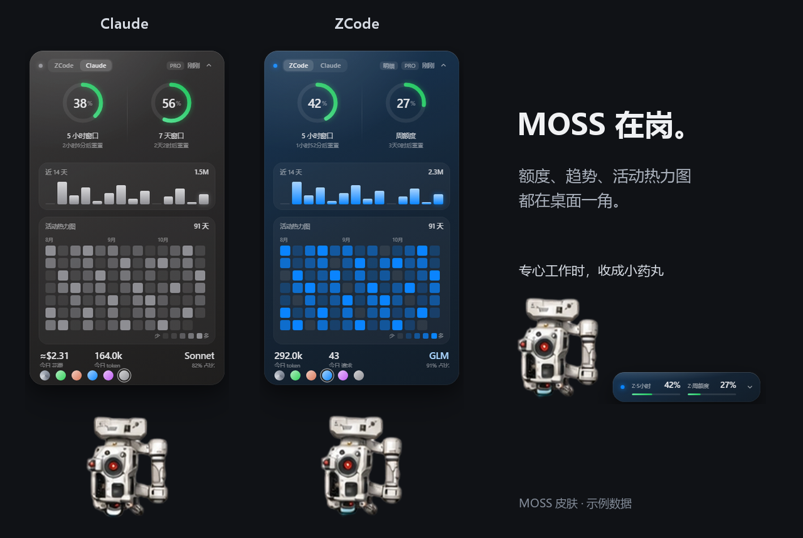

# MOSS Usage Widget

**让 MOSS 陪你写代码，额度进度一眼掌握。**

Claude 和 ZCode 来回用，额度也可以放在一起看。MOSS 把已用比例、重置倒计时和本地用量放到桌面一角：展开卡片看趋势，收成药丸看进度，桌面搭子陪你一起开工。

[开始使用](#开始使用) · [下载源码](https://github.com/Maneck007/moss-usage-widget/releases/latest) · [使用 MOSS 皮肤](docs/APPEARANCE.md) · [配置说明](docs/USAGE.md)

[](https://github.com/Maneck007/moss-usage-widget/actions/workflows/checks.yml)



*图中使用 MOSS 皮肤与示例数据。源码内置简约皮肤，按[外观配置](docs/APPEARANCE.md)可加载图中的 MOSS。*

## 今天的用量，抬眼就有数

| 想看什么 | 桌面上就有 |
|---|---|
| 这一轮用了多少 | Claude / ZCode 已用百分比、额度窗口和重置倒计时 |
| 最近的使用节奏 | 近 14 天用量柱状图、35 / 91 / 140 天活动热力图 |
| 今天的主力模型 | 本地 token、模型占比、ZCode 请求数、Claude 近似成本 |
| 适合自己的摆法 | 卡片 / 药丸切换、拖动定位、多套配色与系统主题 |

用量从容时是绿色，接近上限时变为琥珀和红色，桌面搭子也会切换状态。语音提醒可以按需开启。

## 开始使用

运行环境：**Windows 10/11 + Node.js 22.12+（推荐 24）+ npm**。当前版本通过源码启动。

```powershell
git clone https://github.com/Maneck007/moss-usage-widget.git
cd moss-usage-widget
npm ci
Copy-Item config.example.json config.json
npm start
```

打开面板后，按自己的需要接入数据：

- **本地用量**：读取已有的 Claude / ZCode 会话日志，展示 token、趋势和活动热力图。
- **账号额度**：在 `config.json` 中分别填写平台凭据，按[配置说明](docs/USAGE.md#数据与配置)完成同步。
- **桌面外观**：跟随[皮肤教程](docs/APPEARANCE.md)换上 MOSS；拖动到顺手的位置，点击搭子或按 `Ctrl+Alt+M` 切换视图。

依赖安装好后，也可双击 `启动.vbs` 静默启动。自动跟随应用、主题、提醒和卸载方法见[使用说明](docs/USAGE.md)。

## 数据说明

账号额度来自平台接口，本地用量来自会话日志，面板分别展示两种口径。Claude 同步使用本人登录状态，按页面提示完成验证；本地成本按会话记录近似归属。详细字段和凭据配置见[数据说明](docs/USAGE.md#数据与配置)。

## 来源与参与

MOSS 皮肤由 **skerio** 发布于 [Codex Pet 社区](https://codex-pet.org)，形象来自《流浪地球》系列。皮肤来源和获取方式见[外观配置](docs/APPEARANCE.md)。

界面思路与部分样式参考 [yuemuqing-thu/claude-usage-widget](https://github.com/yuemuqing-thu/claude-usage-widget)，声明见 [THIRD_PARTY_NOTICES.md](THIRD_PARTY_NOTICES.md)。自有代码采用 [MIT 许可](LICENSE)，第三方形象与素材保留各自权利。

欢迎到 [Issues](https://github.com/Maneck007/moss-usage-widget/issues) 分享使用体验，或按[贡献说明](CONTRIBUTING.md)提交改进。本项目借助 AI 编程工具开发，由维护者审阅与验证。
