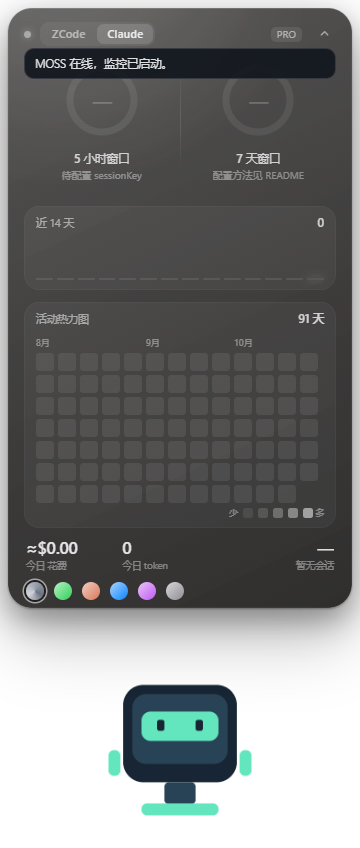

# MOSS 配置与使用说明

[返回项目首页](../README.md)

## 数据与配置

| 内容 | 来源 | 配置 |
|---|---|---|
| ZCode 编码计划额度 | 智谱用量接口 | 本地 `config.json` 的 `bigmodelApiKey` |
| Claude 订阅额度 | 隐藏浏览器窗口加载 claude.ai 用量页，捕获页面响应 | 本地 `claudeSessionKey`；可能需要本人登录或完成人机验证 |
| Claude 本地统计 | `~/.claude/projects/` 的会话日志 | 无需密钥 |
| ZCode 本地统计 | `~/.zcode/cli/rollout/` 的推理日志 | 无需密钥 |

Claude 额度同步依赖未公开承诺稳定的网页行为。sessionKey 是账号凭据，只填写在自己的 `config.json`，不要放入 Issue、截图、聊天或仓库。登录方式与 Cookie 名称以你实际使用的 claude.ai 页面为准；本工具不会自动提取浏览器凭据。

Claude 额度使用 Electron Chromium 网络栈及其系统代理配置；实际出口应以启动日志为准。使用相同网络栈并不保证与另一个客户端具有相同 TLS 指纹，也不能保证账号无风险。留空 `claudeSessionKey` 可只使用本地统计。

本地成本展示来自会话累计成本的近似归属，不是订阅账单或额外扣费。缺少日志或相应字段时不会有完整统计。

## 操作

| 操作 | 效果 |
|---|---|
| 左键机器人 / Ctrl+Alt+M | 切换卡片与药丸 |
| 拖动机器人或卡片顶栏 | 移动窗口 |
| 卡片顶部标签 | 切换 ZCode / Claude |
| 底部色点 | 跟随系统或选择主题 |
| 热力图天数标签 | 切换 35 / 91 / 140 天 |
| ZCode 的“明细”按钮 | 查看额度详情 |
| 右键机器人 | 刷新、大小、跟随启动、配置与退出 |

额度状态色为绿色、琥珀色（≥60%）、红色（≥85%）。药丸可轮换两平台数据；语音告警通过 `ttsWarning` 开启，默认关闭。

## 本地文件与卸载

配置在项目目录的 `config.json`，统计缓存和位置在 `~/.moss-usage-widget/`，网页会话在 Electron 的本地持久分区。这些文件都不应上传。

如果开启了跟随启动，先从右键菜单关闭，再退出应用并删除项目目录。若曾手动启用 `installStatusline`，按备份恢复 `~/.claude/settings.json` 中对应字段。清除本机缓存和 Electron 持久会话时先确认不再需要它们。

未配置账号时的首次启动界面：

